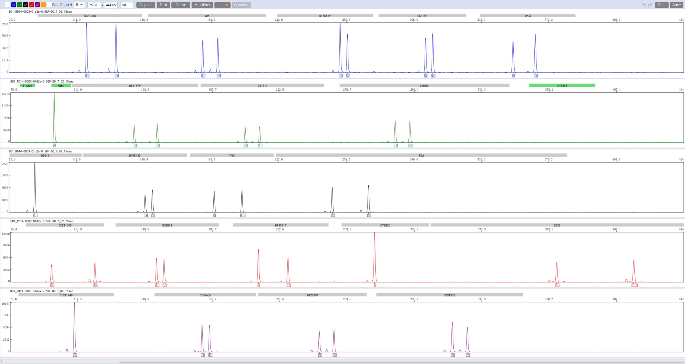
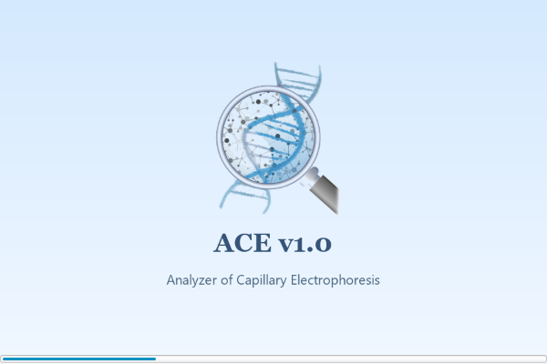
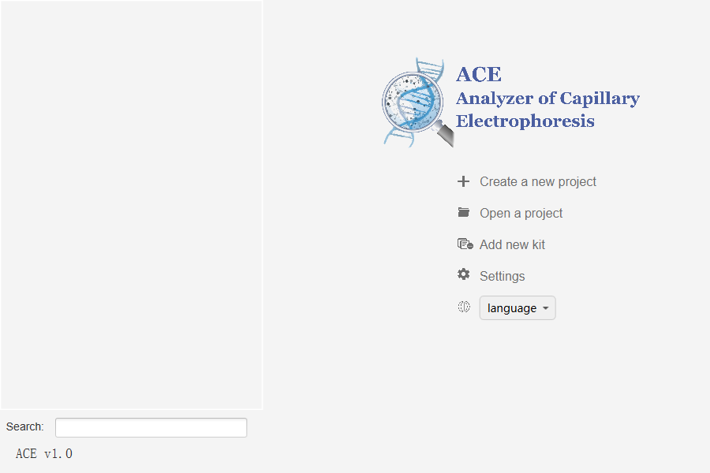
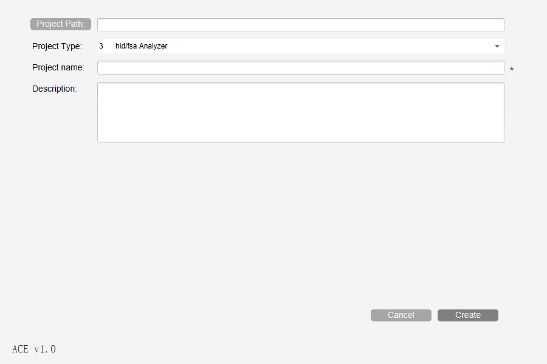
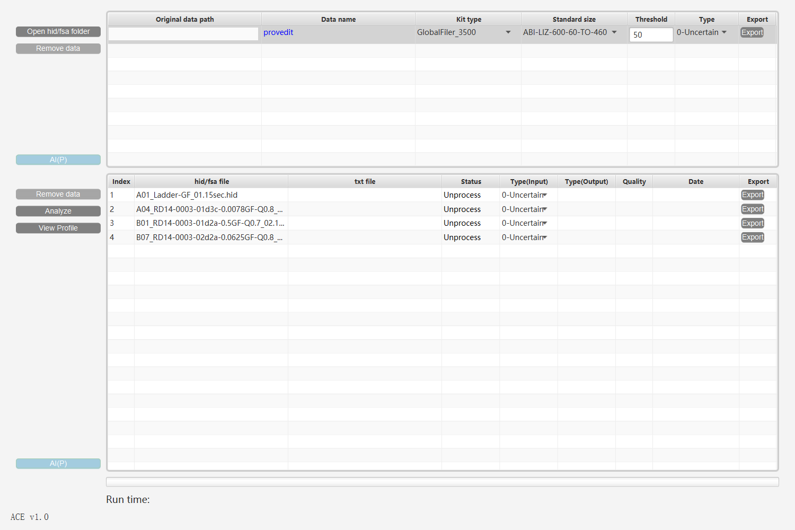
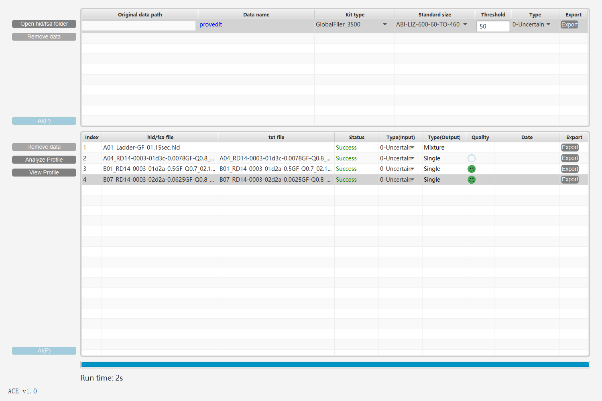

# ACE — Analyzer of Capillary Electrophoresis

ACE is an intelligent, high-throughput signal processing and probabilistic STR genotyping platform for capillary electrophoresis (CE). It automates the complete workflow from raw **HID/FSA** files through peak detection, internal size-standard sizing, allelic ladder fitting, allele designation, and probabilistic peak curation in an interactive graphical environment.

ACE is developed in **Java and C**. The Windows application is distributed as **`ACE.exe`**, with an included Java runtime. This repository provides an illustrated user guide and a small demonstration dataset from the public PROVEDIt collection. Download the application from [Figshare](https://figshare.com/s/a3ac90e47f505f1912c1).



---

## Key Features

- **End-to-End Automated Genotyping**: Directly parses raw ABI 3500 (`.hid`) and ABI 3130 (`.fsa`) capillary electrophoresis files without third-party converters.

- **Robust Sizing & Ladder Fitting**: Supports standard internal size standards (e.g., ABI-LIZ-600, ABI-LIZ-500) and commercial STR amplification kits (e.g., GlobalFiler, Identifiler).

- **Probabilistic Artifact Curation**: Automated discrimination and removal of PCR stutter (−1 and +1 slippage), spectral pull-up, dye blobs, and voltage spikes, while preserving true alleles and supported stutter for downstream probabilistic genotyping (STRmix™, EuroForMix, TrueAllele®).

- **Interactive Multi-Dye Visualization**: Full 5-dye and 6-dye electropherogram viewer with allelic bin overlays, manual peak curation dialogs, and instant zoom/pan controls.

- **Auditable Quality Scoring**: Sample-level and peak-level quality indicators with complete traceability.

---

## Download & Installation

### Windows Executable

1. Open the [Figshare download page](https://figshare.com/s/a3ac90e47f505f1912c1) and download **`ACE.exe`** (~302 MiB).
2. Double-click **`ACE.exe`** and choose a new or empty, writable program folder on first launch.
3. Selecting `D:\ACE` places the program files directly in **`D:\ACE`** and sets the default results folder to **`D:\ACE_results`**.
4. Click **Start ACE**. The first run prepares the included application and Java runtime; later launches remember the selected folder and reuse the installation.

> [!NOTE]
> The executable includes the Java runtime (Zulu JRE 22), the ACE icon and a high-DPI folder-selection window. No separate Java installation or environment-variable configuration is required. Windows 64-bit and .NET Framework 4.8 are required. Allow about 1 GB of free space for the program, plus space for your results. Software authorization is required.

The application sets a 4 GiB Java heap limit. Existing results are retained on subsequent launches. Project files follow the project location you choose inside ACE. See the [operating guide](docs/USER_GUIDE.md#launch) for path settings.

### ACE v1.0 loading screen

The loading screen displays the ACE name and version.



---

## PROVEDIt Example Walkthrough

The repository includes a small demonstration subset from the public **PROVEDIt** collection in [examples/provedit](examples/provedit). It contains one GlobalFiler allelic ladder and three single-source HID profiles (3.30 MiB total; inputs: **0.5000 ng**, **0.0625 ng**, and **0.0078 ng**).

### Step 1: Start ACE & Create Project

Launch ACE to access the main welcome screen. Click **Create a new project**.



In the project creation dialog:

- **Project Path**: Choose an existing, writable parent directory (e.g., `D:\test\projects`).

- **Project Type**: Select `3 — hid/fsa Analyzer`.

- **Project Name**: Enter a name (e.g., `PROVEDIt-demo`).
- Click **Create**.



### Step 2: Import Capillary Electrophoresis Data

1. In the analysis workspace, click **Open hid/fsa folder** and select the [examples/provedit](examples/provedit) folder.
2. In the upper batch table, verify and adjust the analysis parameters:

| Parameter | Example Value | Note |
| :--- | :--- | :--- |
| **Kit type** | `GlobalFiler_3500` | Applied Biosystems™ GlobalFiler™ 24-locus multiplex |
| **Standard size** | `ABI-LIZ-600-60-TO-460` | GeneScan™ 600 LIZ™ size standard (60–460 bp sizing window) |
| **Threshold** | `50` RFU | Analytical threshold for the bundled example |
| **Initial Type** | `0-Uncertain` | Automatically classified during downstream processing |



### Step 3: Automated Genotyping & Artifact Curation

1. Select the batch row and click **AI(P)**.
2. The processing engine performs sizing, ladder alignment, allele calling, and probabilistic artifact filtering across all channels.
3. Upon completion, the lower table displays sample status, contributor classification, and quality indicators:



- **Status**: Reports **`Success`** for all profiles.

- **Routing**: Single-source profiles are classified as `Single`. The allelic ladder is routed as `Mixture` (internal calibration flag, not a biological contributor count).

- **Quality**: The 0.5000 ng and 0.0625 ng profiles show green quality symbols; the 0.0078 ng profile has a different indicator. These symbols and Success status do not independently establish complete allele recovery or genotyping accuracy; inspect the traces and reference genotypes.

### Step 4: Electropherogram Inspection & Export

1. Highlight any sample row and click **View Profile** to open the interactive 5-dye electropherogram viewer.
2. Inspect allelic bins, individual peak heights, and automated artifact removal.
3. Click **Export** to save genotype tables. Exported `.txt` files conform to standard forensic table layouts (`Sample Name`, `Marker`, `Allele`, `Size`, `Height`). Reference outputs are provided in [examples/observed-output](examples/observed-output).

---

## License

ACE is distributed as compiled proprietary software and requires software-owner authorization. Third-party components remain subject to their own licenses and copyright notices. The demonstration data terms and provenance are documented in [examples/provedit](examples/provedit).

## Data Attribution & Citation

The demonstration profiles were derived from the open-access **PROVEDIt** resource:
> Alfonse LE, Garrett AD, Lun DS, Duffy KR, Grgicak CM. A large-scale dataset of single and mixed-source short tandem repeat profiles to inform human identification strategies: PROVEDIt. *Forensic Science International: Genetics*. 2018;32:62–70. [doi:10.1016/j.fsigen.2017.10.006](https://doi.org/10.1016/j.fsigen.2017.10.006).

Official data repository: [PROVEDIt Database, Rutgers University](https://lftdi.camden.rutgers.edu/provedit/files/).

---

## Repository Structure

```text
├── README.md               # Master English documentation
├── docs/
│   ├── USER_GUIDE.md       # Detailed software operations & troubleshooting
│   ├── VERIFICATION.md     # Demonstration run and known observations
│   └── images/             # Application & electropherogram screenshots
└── examples/
    ├── provedit/           # Curated PROVEDIt raw HID profiles & manifest
    └── observed-output/    # Example exported genotype tables
```

