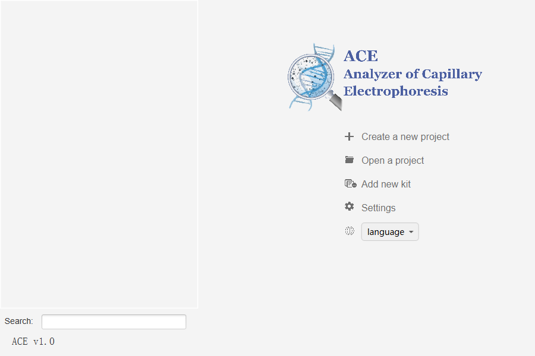
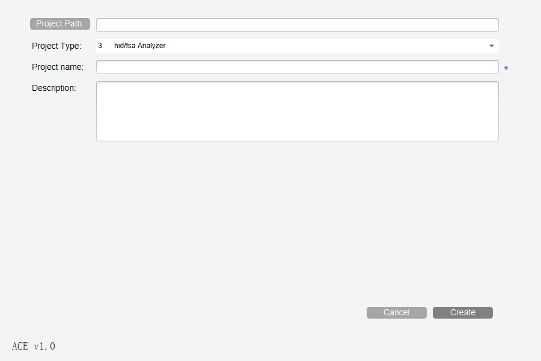
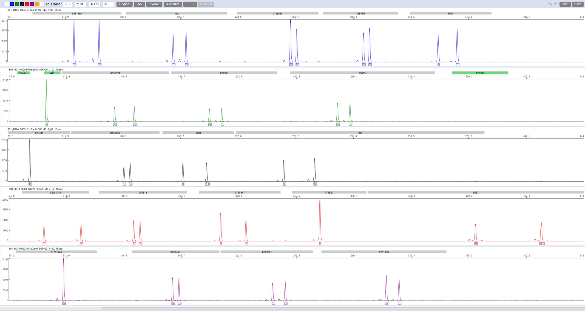

# ACE operating guide

## Launch

ACE is developed in **Java and C**. Download **`ACE.exe`** (~302 MiB) from the [Figshare download page](https://figshare.com/s/a3ac90e47f505f1912c1).

Double-click **`ACE.exe`** and select a new or empty, writable folder on first launch. The window displays both program and default results paths before you click **Start ACE**.

| Selection | Program files | Default results |
| --- | --- | --- |
| `D:\ACE` | `D:\ACE` | `D:\ACE_results` |
| Default: `%LOCALAPPDATA%\ACE` | `%LOCALAPPDATA%\ACE` | `%LOCALAPPDATA%\ACE_results` |

Program files are installed directly in the selected folder. The first launch prepares the application and included Java runtime; later launches reuse the installation and remember the choice. Cancelling the folder window does not install the program or save the choice. Existing results are retained. The launcher uses the ACE icon and supports high-DPI displays.

Allow about 1 GB of free space for the program, with additional space for results. The executable requires Windows 64-bit and .NET Framework 4.8; a separate Java installation is unnecessary. Keep `ACE.exe` in its download location while choosing a separate new installation folder. If a folder already contains an older nested installation or unrelated files, choose a different new folder; existing files are not moved automatically.

The saved choice is stored per Windows user in `%LOCALAPPDATA%\ACE\launcher-location.txt`. To choose again, close ACE and remove this settings file, then relaunch. An unavailable saved folder also prompts for another choice.

The default results folder above is separate from the project location selected in ACE. Project records and exports follow the application's project and export settings described below.

The loading page and main screen display **ACE v1.0**. The executable contains the application and its bundled runtime.

## Project and import

On the welcome screen choose **Create a new project**. Choose an existing parent folder using **Project Path**, select **3 — hid/fsa Analyzer**, enter a name and click **Create**. The tested build did not successfully create a missing parent directory, so create or select the parent folder first.

Use **Open hid/fsa folder** to select the directory containing raw profiles. The upper table represents the imported folder/batch. It exposes the source path, data name, **Kit type**, **Standard size**, **Threshold** and initial **Type**. Keep the allelic ladder with the sample files for the demonstration.

For the bundled data select `GlobalFiler_3500`, `ABI-LIZ-600-60-TO-460`, `50` RFU and `0-Uncertain`. For other experiments choose settings that match the amplification kit, instrument and internal size standard.

## Analysis and inspection

Select the imported batch and click the upper **AI(P)** button. The lower results table reports **Status**, **Type(Input)**, **Type(Output)** and **Quality**, with actions for individual records. The ACE v1.0 demonstration displayed four **Success** records, with the three samples classified **Single** and the ladder classified **Mixture**.

Select a sample row and use **View Profile**. The viewer shows traces by dye channel, locus regions and assigned allele labels. It also exposes filtering and manual editing controls. Inspect the 0.0078 ng sample carefully because low signal can cause missing alleles even when file processing succeeds.

The tested batch’s displayed runtime was 2 s. This is a single local GUI observation for four records, including a ladder; it excludes installation/import and is not a hardware-independent performance claim.

## Output files

The observed project stored records under `RawData/provedit/`. The exact project name and location depend on the user’s chosen project.

| File | Observed role |
| --- | --- |
| `*.hid` | Imported copy of a raw input file |
| Sample `*.txt` | Tab-delimited marker, allele, fragment-size and peak-height records |
| `*.all` | Internal analysis state used by the application |
| `*.changes` | Internal peak-change records; format not independently specified here |
| `*.status`, `info.txt` | Batch/project state, which may contain absolute local paths |

Use **Export** to request the application’s batch or record export. The reference TXT files in this repository were copied from the generated project directory. Keep an intact local project if reopening or reviewing analyses is needed; sharing only TXT tables does not preserve the complete project.

## Troubleshooting

| Observation | Action |
| --- | --- |
| No HID files are visible in the folder chooser | Select their containing folder; the dialog selects directories. |
| Create does not enter the workspace | Confirm the project parent folder already exists and is writable. |
| Startup reports authorization failure | Obtain authorization from the software owner. This package retains the existing checks. |
| The ladder is marked Mixture | Treat it as a calibration record and exclude it from donor-sample interpretation. |
| A Success record has a warning/blank quality symbol | Inspect its electropherogram and reported calls. Success describes processing completion. |
| ACE.exe rejects the selected program folder | Choose a new or empty, writable folder, or a recognized installation made by the same launcher. |
| ACE.exe prompts for a folder again | Reconnect the saved drive or choose a writable folder; settings are saved separately for each Windows user. |
| ACE.exe cannot prepare or start the application | Confirm that the selected folder is writable, sufficient space is available, and .NET Framework 4.8 is installed. |
| Local paths appear in project files | Keep the full project local or redact a copy before external sharing. |

JavaFX style warnings occurred during the successful demonstration. The missing-parent-folder error was resolved by creating the parent folder.

